# Sovelluksen kuvat

Tässä kansiossa ovat kaikki kuvat, joita sovellus käyttää.

Kuvia on kolmea lajia:

- vaatteiden kuvat
- ukon kuvat
- esimerkit jokaisesta kuukaudesta.

Sovellus piirtää kuvat itse.
Tämän kansion kuvat ovat kopioita katselua varten.

## Vaatteet

Jokaisella vaatteella on kuva ja nimi.
Nimen alla lukee, milloin vaate puetaan.

### Alusvaatteet

<table>
<tr>
<td align="center" valign="top" width="156"><br><b>Alushousut</b><br>Aina.</td>
<td align="center" valign="top" width="156">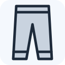<br><b>Pitkät alushousut</b><br>Kun on kova pakkanen.</td>
<td align="center" valign="top" width="156"><br><b>Sukat</b><br>Melkein aina.</td>
<td align="center" valign="top" width="156">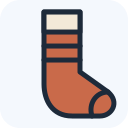<br><b>Lämpimät sukat</b><br>Kun on pakkasta.</td>
<td align="center" valign="top" width="156">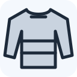<br><b>Pitkä aluspaita</b><br>Kun on kova pakkanen.</td>
</tr>
</table>

### Paidat

<table>
<tr>
<td align="center" valign="top" width="156">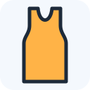<br><b>Hihaton paita</b><br>Kun on helle.</td>
<td align="center" valign="top" width="156"><br><b>T-paita</b><br>Kun on lämmin.</td>
<td align="center" valign="top" width="156">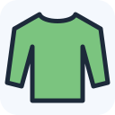<br><b>Pitkähihainen paita</b><br>Kun on vähän viileää.</td>
<td align="center" valign="top" width="156">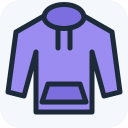<br><b>Lämmin paita</b><br>Kun on viileää.</td>
<td align="center" valign="top" width="156">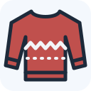<br><b>Villapaita</b><br>Kun on kylmä.</td>
</tr>
</table>

### Takit

<table>
<tr>
<td align="center" valign="top" width="156">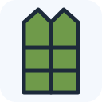<br><b>Liivi</b><br>Kun on melkein lämmin.</td>
<td align="center" valign="top" width="156">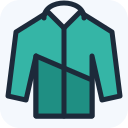<br><b>Tuulitakki</b><br>Kun tuulee.</td>
<td align="center" valign="top" width="156">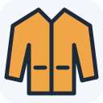<br><b>Takki</b><br>Kun on viileää.</td>
<td align="center" valign="top" width="156">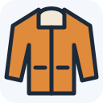<br><b>Lämmin takki</b><br>Syksyllä, kun on viileää.</td>
<td align="center" valign="top" width="156">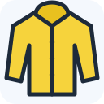<br><b>Sadetakki</b><br>Kun sataa.</td>
</tr>
<tr>
<td align="center" valign="top" width="156">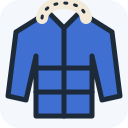<br><b>Talvitakki</b><br>Kun on kylmä.</td>
<td align="center" valign="top" width="156">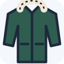<br><b>Paksu talvitakki</b><br>Kun on kova pakkanen.</td>
</tr>
</table>

### Housut

<table>
<tr>
<td align="center" valign="top" width="156"><br><b>Shortsit</b><br>Kun on kuuma.</td>
<td align="center" valign="top" width="156">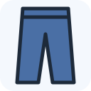<br><b>Pitkät housut</b><br>Melkein aina.</td>
<td align="center" valign="top" width="156">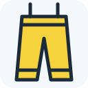<br><b>Sadehousut</b><br>Kun sataa paljon.</td>
<td align="center" valign="top" width="156">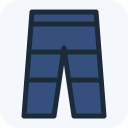<br><b>Lämpimät housut</b><br>Kun on pakkasta.</td>
</tr>
</table>

### Kengät

<table>
<tr>
<td align="center" valign="top" width="156"><br><b>Sandaalit</b><br>Kun on kuuma ja kuivaa.</td>
<td align="center" valign="top" width="156">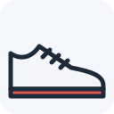<br><b>Lenkkarit</b><br>Kun on kuivaa.</td>
<td align="center" valign="top" width="156">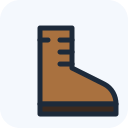<br><b>Paksut kengät</b><br>Kun on viileää.</td>
<td align="center" valign="top" width="156">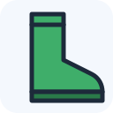<br><b>Kumisaappaat</b><br>Kun sataa tai on loskaa.</td>
<td align="center" valign="top" width="156">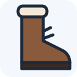<br><b>Talvikengät</b><br>Kun on lunta tai pakkasta.</td>
</tr>
<tr>
<td align="center" valign="top" width="156">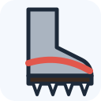<br><b>Liukuesteet kenkiin</b><br>Kun on liukasta.</td>
</tr>
</table>

### Päähineet

<table>
<tr>
<td align="center" valign="top" width="156"><br><b>Lippalakki</b><br>Keväällä ja kesällä.</td>
<td align="center" valign="top" width="156"><br><b>Aurinkohattu</b><br>Kun aurinko paistaa kovaa.</td>
<td align="center" valign="top" width="156">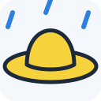<br><b>Sadehattu</b><br>Kun sataa ja tuulee kovaa.</td>
<td align="center" valign="top" width="156"><br><b>Ohut pipo</b><br>Kun on viileää.</td>
<td align="center" valign="top" width="156"><br><b>Pipo</b><br>Kun on kylmä.</td>
</tr>
<tr>
<td align="center" valign="top" width="156">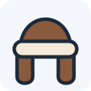<br><b>Karvahattu</b><br>Kun on kova pakkanen.</td>
</tr>
</table>

### Kädet ja kaula

<table>
<tr>
<td align="center" valign="top" width="156"><br><b>Hanskat</b><br>Kun on kylmä.</td>
<td align="center" valign="top" width="156"><br><b>Lapaset</b><br>Kun on pakkasta.</td>
<td align="center" valign="top" width="156"><br><b>Kaulahuivi</b><br>Kun on kylmä tai tuulee.</td>
</tr>
</table>

### Muut tavarat

<table>
<tr>
<td align="center" valign="top" width="156"><br><b>Sateenvarjo</b><br>Kun sataa.</td>
<td align="center" valign="top" width="156"><br><b>Aurinkolasit</b><br>Kun aurinko paistaa.</td>
<td align="center" valign="top" width="156"><br><b>Aurinkorasva</b><br>Kun aurinko paistaa kovaa.</td>
<td align="center" valign="top" width="156">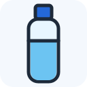<br><b>Vesipullo</b><br>Kun on helle.</td>
<td align="center" valign="top" width="156">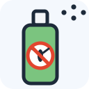<br><b>Hyttyssuoja</b><br>Kesällä, kun on hyttysiä.</td>
</tr>
<tr>
<td align="center" valign="top" width="156">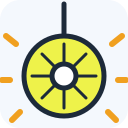<br><b>Heijastin</b><br>Kun on pimeää.</td>
</tr>
</table>

## Ukko

Ukko näyttää, miltä ulkona tuntuu.
Taustan väri kertoo saman asian.

<table>
<tr>
<td align="center" valign="top" width="190">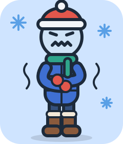<br><b>Kova pakkanen</b><br>Ukko tärisee.</td>
<td align="center" valign="top" width="190">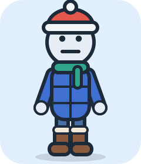<br><b>Kylmä</b><br>Ukolla on pipo. Suu on suora.</td>
<td align="center" valign="top" width="190">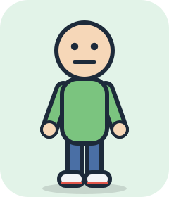<br><b>Viileä</b><br>Ukko seisoo rauhassa.</td>
<td align="center" valign="top" width="190">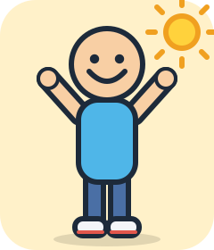<br><b>Lämmin</b><br>Ukko hymyilee. Kädet ovat ylhäällä.</td>
<td align="center" valign="top" width="190">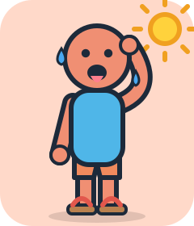<br><b>Kuuma</b><br>Ukko on punainen ja hikoilee.</td>
</tr>
</table>

## Sää ukon kuvassa

Ukon kuvassa näkyy myös sää.

<table>
<tr>
<td align="center" valign="top" width="190">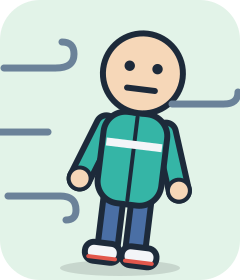<br><b>Tuuli</b><br>Viivat tarkoittavat tuulta. Ukko nojaa tuulessa.</td>
<td align="center" valign="top" width="190"><br><b>Sade</b><br>Siniset pisarat tarkoittavat sadetta.</td>
<td align="center" valign="top" width="190">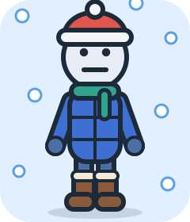<br><b>Lumi</b><br>Valkoiset pallot tarkoittavat lunta.</td>
<td align="center" valign="top" width="190">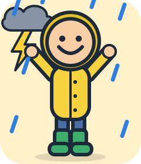<br><b>Ukkonen</b><br>Pilvi ja salama tarkoittavat ukkosta.</td>
</tr>
<tr>
<td align="center" valign="top" width="190">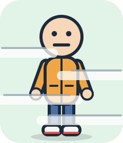<br><b>Sumu</b><br>Vaaleat raidat tarkoittavat sumua.</td>
<td align="center" valign="top" width="190">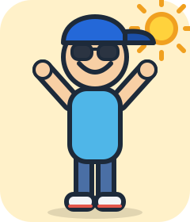<br><b>Aurinko</b><br>Aurinko tarkoittaa, että aurinko paistaa.</td>
<td align="center" valign="top" width="190">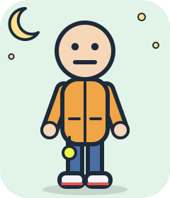<br><b>Pimeä</b><br>Kuu ja tähdet tarkoittavat, että ulkona on pimeää.</td>
</tr>
</table>

## Esimerkki jokaisesta kuukaudesta

Ukolla on päällä vaatteet, joita sovellus ehdottaa.
Säät ovat esimerkkejä. Ne eivät ole oikea sääennuste.

<table>
<tr>
<td align="center" valign="top" width="190">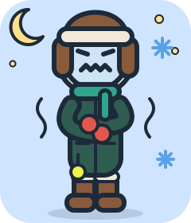<br><b>Tammikuu</b><br>−18 astetta. Hyvin kylmä. Taivas on selkeä. On pimeää.<br>Ukolla on: lämpimät housut, paksu talvitakki, talvikengät, karvahattu, kaulahuivi, lapaset, heijastin.</td>
<td align="center" valign="top" width="190">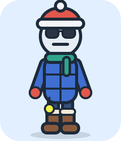<br><b>Helmikuu</b><br>−7 astetta. Kylmä. Aurinko paistaa.<br>Ukolla on: lämpimät housut, talvitakki, talvikengät, pipo, kaulahuivi, lapaset, aurinkolasit, heijastin.</td>
<td align="center" valign="top" width="190"><br><b>Maaliskuu</b><br>0 astetta. Kylmä. Sataa lunta.<br>Ukolla on: pitkät housut, talvitakki, talvikengät, pipo, kaulahuivi, hanskat, heijastin.</td>
</tr>
<tr>
<td align="center" valign="top" width="190">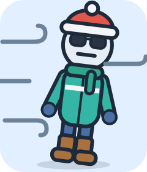<br><b>Huhtikuu</b><br>+6 astetta. Kylmä. On pilvistä. Tuulee.<br>Ukolla on: pitkät housut, tuulitakki, paksut kengät, pipo, kaulahuivi, hanskat, aurinkolasit.</td>
<td align="center" valign="top" width="190">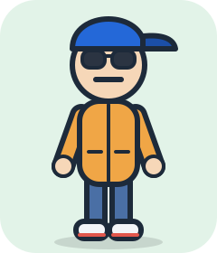<br><b>Toukokuu</b><br>+14 astetta. Viileä. Aurinko paistaa.<br>Ukolla on: pitkät housut, takki, lenkkarit, lippalakki, aurinkolasit.</td>
<td align="center" valign="top" width="190">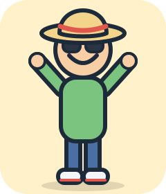<br><b>Kesäkuu</b><br>+19 astetta. Lämmin. On pilvistä.<br>Ukolla on: pitkät housut, pitkähihainen paita, lenkkarit, aurinkohattu, aurinkolasit.</td>
</tr>
<tr>
<td align="center" valign="top" width="190">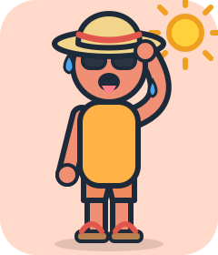<br><b>Heinäkuu</b><br>+27 astetta. Kuuma. Aurinko paistaa.<br>Ukolla on: shortsit, hihaton paita, sandaalit, aurinkohattu, aurinkolasit.</td>
<td align="center" valign="top" width="190">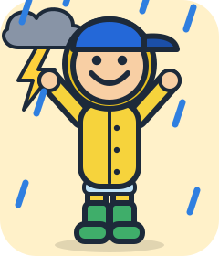<br><b>Elokuu</b><br>+20 astetta. Lämmin. Ukkostaa.<br>Ukolla on: pitkät housut, sadehousut, sadetakki, kumisaappaat, lippalakki.</td>
<td align="center" valign="top" width="190">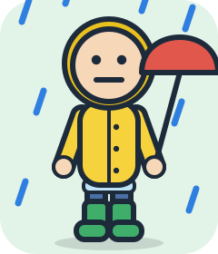<br><b>Syyskuu</b><br>+12 astetta. Viileä. Sataa.<br>Ukolla on: pitkät housut, sadetakki, kumisaappaat, sateenvarjo.</td>
</tr>
<tr>
<td align="center" valign="top" width="190">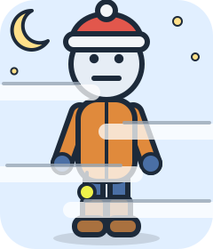<br><b>Lokakuu</b><br>+6 astetta. Kylmä. On sumua. On pimeää.<br>Ukolla on: pitkät housut, lämmin takki, paksut kengät, pipo, hanskat, heijastin.</td>
<td align="center" valign="top" width="190">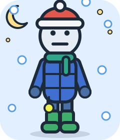<br><b>Marraskuu</b><br>+1 astetta. Kylmä. Sataa lunta. On pimeää.<br>Ukolla on: pitkät housut, talvitakki, kumisaappaat, pipo, kaulahuivi, hanskat, heijastin.</td>
<td align="center" valign="top" width="190">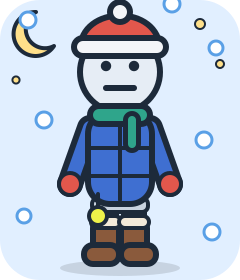<br><b>Joulukuu</b><br>−4 astetta. Kylmä. Sataa lunta. On pimeää.<br>Ukolla on: lämpimät housut, talvitakki, talvikengät, pipo, kaulahuivi, lapaset, heijastin.</td>
</tr>
</table>

## Ohje tekijälle

Älä muuta tämän kansion kuvia käsin.
Kuvat tehdään tiedostosta `app.js`.

Kun muutat sovelluksen kuvia, tee kansio uudelleen tällä komennolla:

```bash
node tools/vie-kuvat.mjs
```
